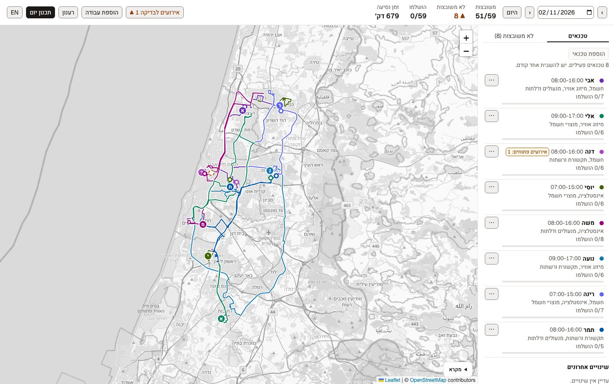
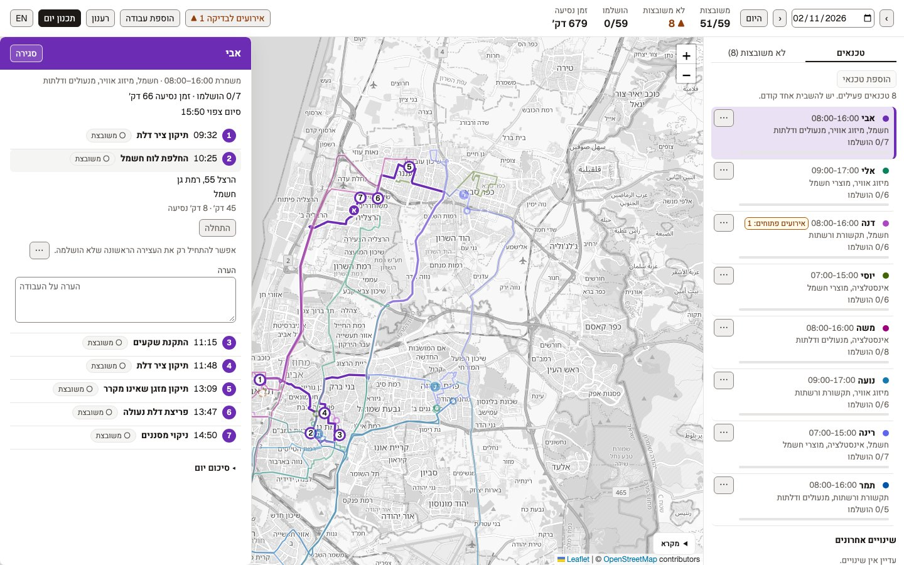
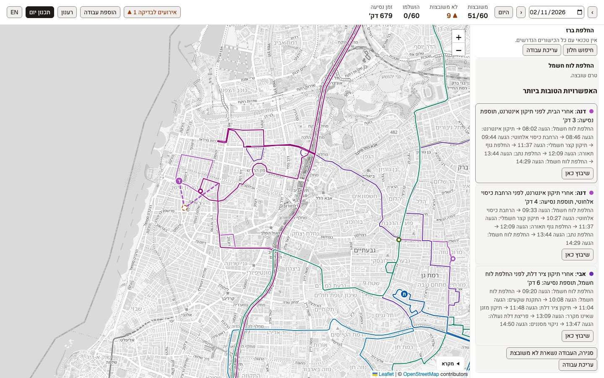
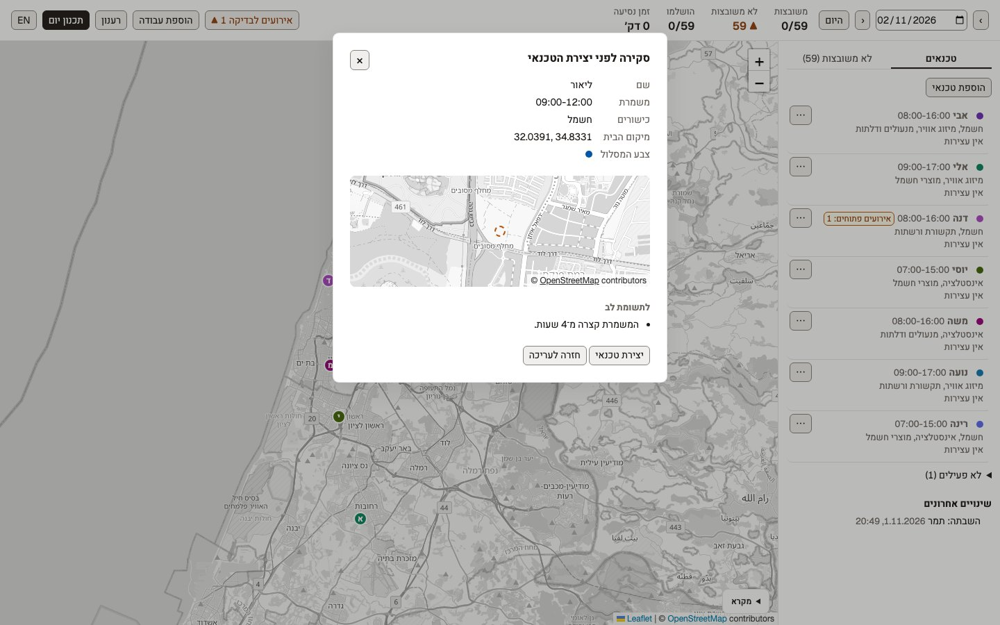
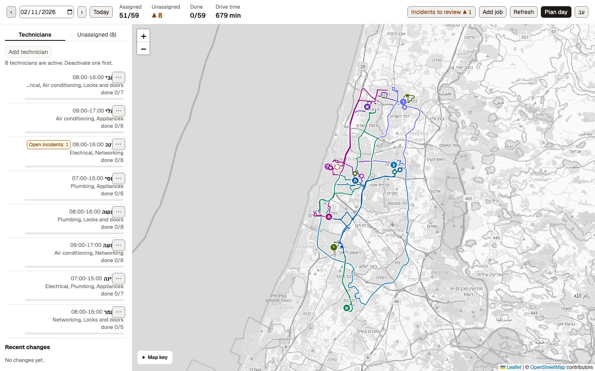
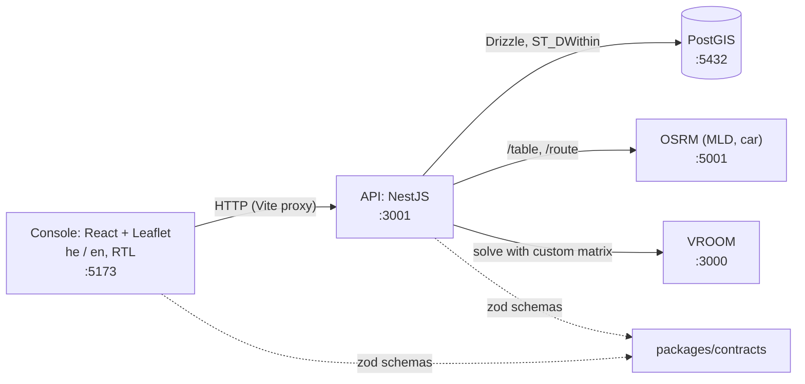

# shibutz

A dispatch console for field technicians, built as a learning project. Technicians have skills, shifts and a home;
jobs have a place, required skills, a service duration, a time window and a priority. A dispatcher plans a whole
day in one batch (OSRM travel times + the VROOM solver), places a late job into existing routes with the smallest
detour (a hand-written insertion heuristic, compared against VROOM), and follows the day as it unfolds. It
demonstrates PostGIS geography queries, routing on OpenStreetMap data, vehicle-routing optimization, forward time
propagation with waiting, and optimistic concurrency, with tests at every seam.



## The console

Hebrew first (right to left) with an English (left to right) toggle; the map keeps its own direction.

- **Plan day** re-optimizes one date; every technician gets a route color, shown on the map and in the list.
- **Work-day drawer:** click a technician to see their stops with ETAs, start, finish, unassign or cancel a stop,
  and keep a free-text **note** per job.
- **Find a slot** places an unassigned job without reordering anyone's stops. Each option shows the detour and the
  stops around it, and previews the new leg on the map as a dashed line.
- **Job editing:** change a job's title and address until it is done or cancelled; its place, skills, duration and window only while
  it has no stop on a route (the server refuses the rest).
- **Technician management:** add, edit, deactivate and reactivate technicians. A **review step** summarizes what
  will change and warns about odd shifts or far-away homes before saving; every change lands in the **change log**.
  An inactive technician keeps their history and is never planned. Up to 8 can be active, one per route color.
- **Day reports and incidents:** an optional end-of-day summary per work day, and incidents to review later.

| Work-day drawer | Find a slot |
|---|---|
|  |  |
| **Add technician, review step** | **Same console in English** |
|  |  |

Design and vocabulary: [`DESIGN.md`](DESIGN.md) (tokens, type, web platform support), [`GLOSSARY.md`](GLOSSARY.md)
(the domain words used in the UI and code), [`docs/adr/`](docs/adr/) (architecture decisions), and
[`docs/console-copy.md`](docs/console-copy.md) (every string in both languages).

## Architecture



- `apps/api`: NestJS (strict TS). `planning/` is the pure core (no I/O); `gateways/` holds the OSRM and VROOM ports.
- `apps/web`: the dispatch console. `packages/contracts`: zod schemas shared by both.

## Quickstart
Needs Docker, Node 24 and pnpm (`corepack enable` is enough).

```sh
git clone https://github.com/raday146/shibutz.git && cd shibutz
nvm use                                    # Node 24
docker compose up -d                       # PostGIS, OSRM, VROOM; first run downloads the Israel extract (~1 min)
pnpm install
pnpm --filter @shibutz/api db:seed         # migrate + 6 skills, 8 technicians, 60 jobs for 2026-11-02
pnpm --filter @shibutz/api start           # API on :3001 (leave running)
pnpm --filter web dev                      # console on :5173 (second terminal)
```

Open http://localhost:5173, pick 2026-11-02, click **Plan day** (the button is labeled in Hebrew; `EN` switches the
language), then click a technician to see their route and ETAs. Pinned image versions and arm64 notes:
`docs/infra.md`; sanity check: `./scripts/smoke.sh`.

## How it works

**Batch optimization** (`POST /optimization/day/:date`)
1. Pre-checks drop jobs that can never be planned and report why: `NO_SKILLED_TECHNICIAN`,
   `WINDOW_OUTSIDE_ALL_SHIFTS`.
2. One OSRM `/table` call gives the duration matrix, rounded up to whole seconds. A job no skilled technician can
   reach and return from (no road in the matrix) is `UNREACHABLE`.
3. That matrix goes to VROOM as a custom matrix (VROOM never routes). Jobs carry skills, time windows, service
   time and priority; each technician starts and ends at home within their shift.
4. VROOM's routes and arrival times are persisted in one write-only transaction. Jobs VROOM drops are reported as
   `NOT_FEASIBLE_IN_PLAN`. Re-running a day replaces its plan; a day with a started stop returns 409.

**Dynamic insertion** (`POST /jobs/:id/insertion-suggestions`, then `POST /jobs/:id/insert`)
- *Candidates:* technicians with all required skills whose stops or home are within `INSERTION_RADIUS_M`
  (PostGIS `ST_DWithin`); if none, all skilled technicians. One OSRM `/table` call for the new job and candidates.
- *Detour:* for each consecutive pair (a, b) after the technician's current position,
  `detour = t(a,new) + t(new,b) - t(a,b)`; the last leg is (last stop, home).
- *Feasibility, forward propagation with waiting:* `arrival = previous departure + travel`;
  `service starts at max(arrival, window start)`; it must start by the window end; the return home must beat the
  shift end. Waiting absorbs part of a detour, so a naive "shift every later stop" check would wrongly reject slots.
- *Current position:* the in-progress stop, else the last done stop, else home, each no earlier than now.
- *Result:* the best options by detour (ties: shorter total route, then technician id), plus a rejection reason
  per technician (`MISSING_SKILL`, `ROUTE_ALREADY_LATE`, `NO_FEASIBLE_POSITION`).
- *Versioned commit:* each option carries the route's `version`. `insert` recomputes feasibility on fresh data,
  then in one transaction does `UPDATE routes SET version = version + 1 WHERE ... AND version = ?`; zero rows
  means 409. A technician with no route yet is version 0, and two racing first inserts give one 200 and one 409.

Other endpoints: CRUD for `/skills`, `/technicians`, `/jobs`; `POST /technicians/:id/deactivate` and `/reactivate`;
`GET /technician-changes` (the change log); `PATCH /jobs/:id/status` (assigned, in_progress,
done, unassigned, cancelled; each change bumps the route version); `GET /routes/:technicianId/:date` (stops, ETAs,
GeoJSON line from OSRM). `pnpm --filter @shibutz/api compare` prints the heuristic vs VROOM report
(`docs/comparison-report.md`: 124.3 vs 123.6 min fleet drive time on the scenario).

## Key decisions
The spec is [issue #1](https://github.com/raday146/shibutz/issues/1); it supersedes `docs/BRIEF.md`. Highlights:
- A custom VROOM matrix built from one OSRM call, so batch, heuristic and scheduling use identical numbers.
- No external calls inside a DB transaction: compute first, then write, guarded by the route version.
- A time window bounds when service *starts* (VROOM's semantics), everywhere.
- Shifts are daily local times of day (Asia/Jerusalem); overnight shifts are rejected. Times are UTC in the DB and
  seconds since local midnight at the solver boundary.
- Coordinates are `[lon, lat]` everywhere, owned by one helper. Single-day planning, drive-time objective.
- Drizzle with visible spatial SQL; zod contracts shared with the web app; Leaflet on OSM tiles.

## Testing
```sh
pnpm typecheck && pnpm lint
pnpm test                                   # unit tests: planning core, mapping, prechecks, seed (Jest)
pnpm test:e2e                               # e2e + integration, against compose PostGIS
pnpm --filter web test                      # web unit tests (Vitest)
pnpm --filter web test:e2e                  # browser checks (Playwright: chromium, webkit, firefox; the API is mocked)
pnpm --filter web test:e2e --project=chromium   # one engine, for a quick local run
# first time: pnpm --filter web exec playwright install chromium webkit firefox
```
- CI (`.github/workflows/ci.yml`) runs on every pull request and on pushes to `main`: typecheck, lint, unit tests,
  then e2e against a PostGIS service container with Playwright on all three engines. OSRM and VROOM are not started
  there, so the tests that need them skip.
- E2E boots the real app against `shibutz_test`, truncating between tests, `--runInBand`. Set `TEST_DB_NAME` per
  worktree so parallel runs do not share a database. Batch e2e uses real VROOM with a fake routing gateway.
- `*.int-spec.ts` tests hit real OSRM/VROOM (matrix shape, timeouts, `scheduleRoute` reproducing VROOM's arrival
  times exactly) and are skipped when the service is down.
- Env overrides: `DATABASE_URL`, `TEST_DB_NAME`, `INSERTION_RADIUS_M` (default 10000), `OSRM_URL`, `VROOM_URL`, `PORT`.
- `db:seed` and `db:scenario` wipe skills, technicians and jobs; the seed is deterministic (fixed PRNG and day).

## Known limitations
Accepted on purpose for this learning project (see the closed issues for the reasoning):
- **Cancelling an `in_progress` job deletes its stop**, so its `actual_departure` is not stored; the cancel time is
  only used as the start of the ETA recompute (#13). Planned-vs-actual metrics can't see cancelled stops.
- **Check-then-write guards**: `DELETE /technicians/:id`, edits to a routed job's location, window, service
  duration or skills, and edits to an active technician's home, shift or skills are refused by a pre-check, not a
  lock, so a batch or insert committing in the same instant can slip past. Re-running the batch repairs the result (#15).
- After a `done` stop the technician is assumed to still be at that stop (no GPS).
- Planned `eta`/`etd` of later stops are not rewritten when a stop is marked `done` or `in_progress`; actual times
  live in `actual_arrival`/`actual_departure`.
- Open follow-ups are the `needs-triage` [issues](https://github.com/raday146/shibutz/issues), for example a possible lock-order deadlock between batch and status changes (#20) and per-day technician availability (#32).

## Data and credits
- Map data and tiles are © [OpenStreetMap](https://www.openstreetmap.org/copyright) contributors, available under the
  [Open Database License (ODbL)](https://opendatacommons.org/licenses/odbl/). The console shows the attribution on
  every map. Tiles come from the public OSM tile server, which suits a demo, not heavy traffic.
- Routing uses an [Israel and Palestine extract from Geofabrik](https://download.geofabrik.de/asia/israel-and-palestine.html)
  of OSM data. `docker compose up` downloads it into `data/` (git-ignored); it is not part of this repository.
- Built on [OSRM](https://project-osrm.org/) (routing), [VROOM](https://github.com/VROOM-Project/vroom) (solver),
  [PostGIS](https://postgis.net/) and [Leaflet](https://leafletjs.com/). Fonts: Geist and Heebo (SIL OFL) via Fontsource.
- The seed technicians and jobs are synthetic.

## License
[MIT](LICENSE), © 2026 Shlomo Raday.
